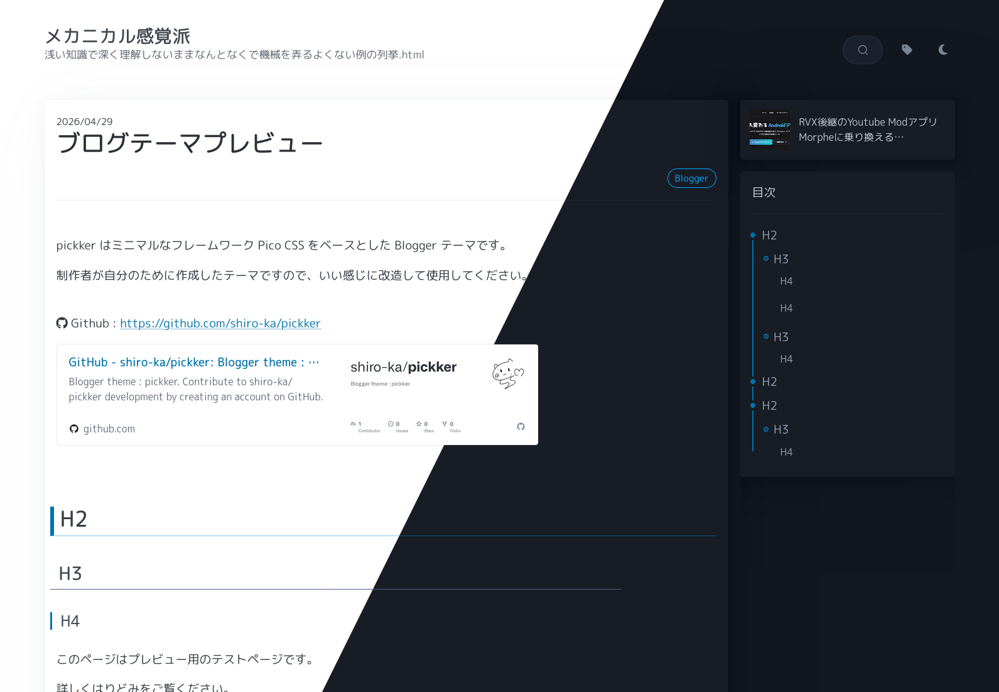
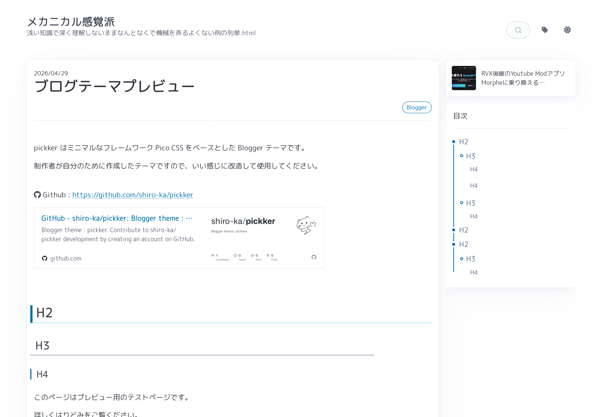
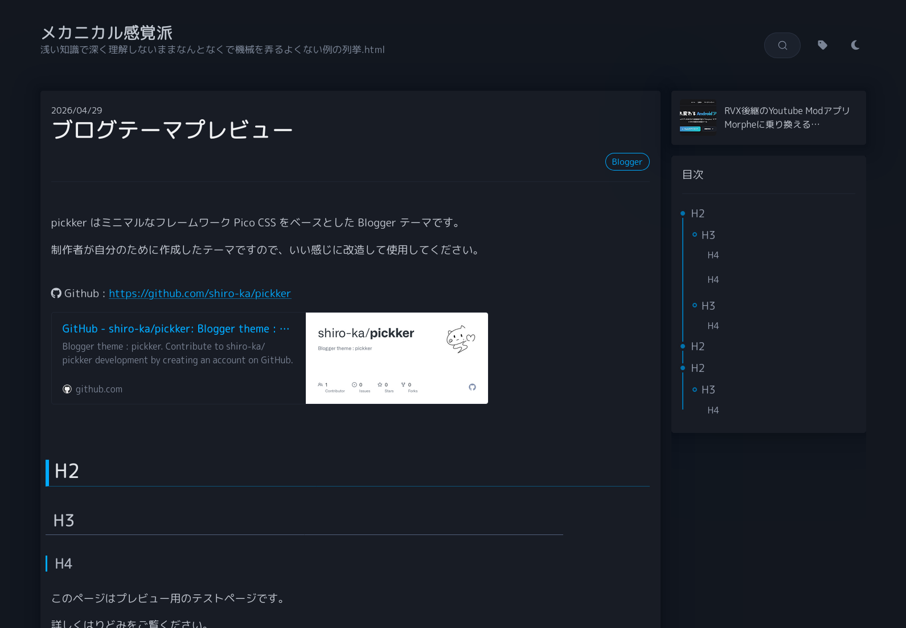

# pickker



---

[Pico CSS](https://picocss.com) をベースとした Blogger テーマ

<br>

## features

- マークダウン利用
- 目次自動生成
- リンクカード生成
- ダークモード対応

<br>

## install / use

[oqlbodlpo.blogspot.com/2026/04/bloggerpickker](https://oqlbodlpo.blogspot.com/2026/04/bloggerpickker.html)

<br>

## notes

- 本文は **HTML ビュー**で書く。作成ビューは `<div>` や `<br>` を勝手に混ぜる。
- 改行が意図せず二重になる場合は Blogger の投稿設定にある改行オプションを見直す。
  エディタが `<br>` を自動挿入していると、`html: true` の markdown-it を素通りして
  テーマ側の改行処理と二重にかかる。
- Markdown は標準ではなく以下の拡張が入っている。標準に戻したい場合は `src/app.js` の
  `renderMarkdown()` にコメントで戻し方を書いてある。
  - 単一改行を `<br>` にする (`breaks: true`)
  - 連続した空行を縦の余白として残す
- リンクカードは **段落がリンク単体のときだけ**生成される。文中のリンクには付かない。

<br>

## develop

`pickker.xml` は **生成物**。編集するのは `src/` の中身。

```
src/theme.xml   Blogger のテンプレート (b: タグ・ウィジェット定義)
src/style.css   スタイル
src/app.js      全ページ共通 (テーマ切替 / Markdown / 目次 / リンクカード)
src/feed.js     一覧ページ (ホーム / ラベル / 検索 / アーカイブ)
src/related.js  記事ページの関連記事
```

```sh
node build.mjs           # src/ から pickker.xml を生成 (+ XML 検査)
node build.mjs --check   # pickker.xml が src と一致するか確認
```

Blogger はテーマを XML としてパースするので `<style>` `<script>` の中身は
`&` `<` `>` をエンティティに直す必要がある。build.mjs がそれをやるため、
`src/` 側は素の CSS / JS のまま書ける。`src/theme.xml` の `@@INCLUDE:foo@@`
がその差し込み位置（入れ子は非対応）。

`legacy/suisou-v2/` は [Suisou](https://github.com/shiro-ka/Suisou) v2 をベースにした旧版（更新停止）。

<br>

## preview

### Light



### Dark


